## Kontinuitäts-Gleichung

Für die stationäre Näherung (keine Zeitableitungen der Felder) ergibt sich aus den Maxwell-Gleichungen (Amperesches Durchflutungsgesetz) und dem ohmschen Gesetz
$$\curl \vb H = \vb j = \sigma \vb E + \vb j_s$$

Dabei setzt sich die Stromdichte aus einem Anteil des im Untergrund (aufgrund der Leitfähigkeit $\sigma$) und einem Quellstromterm $\vb j_s$ zusammen.
Wir bilden die Divergenz der letzten Gleichung, und nutzen die Divergenzfreiheit von Wirbelfeldern ($\div\curl\vb F=0$):

$$\div \curl\vb H = \div\vb j=\div(\sigma\vb E) + \div\vb j_s=0$$

Daraus ergibt sich die Kontinuitätsgleichung:

$$-\div(\sigma\vb E)=-\div(\sigma\grad U)=\div\vb j_s$$

Diese partielle Differential-Gleichung (PDE) ist eine Poisson-Gleichung & beschreibt die Potentialverteilung für beliebige Verteilungen der Leitfähigkeit $\sigma$.
Im Allgemeinen lösen wir sie numerisch, für einfache Fälle analytisch.

### Das Konzept der Punktquelle

Wir gehen zunächst von einer punktförmigen Einspeisung des Stroms aus.

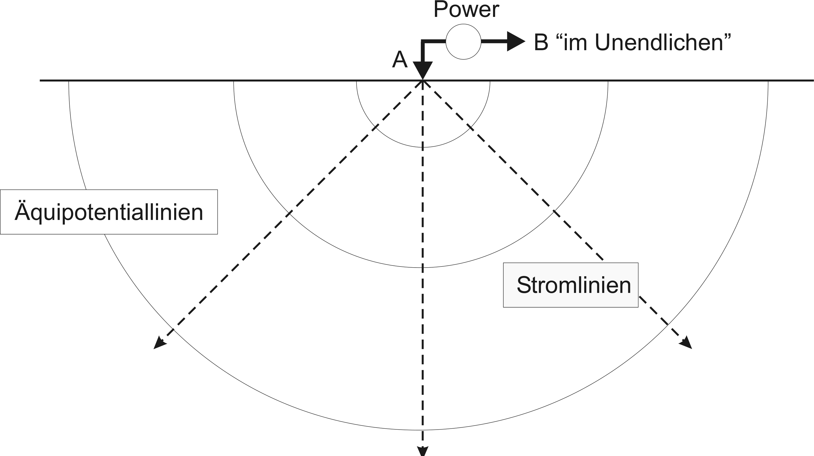

Elektroden sind "klein" (gegenüber Abstand zu Potentialmessung), der Gesamt-Strom (Integral) beträgt $I$:

$$\div\vb j = I \delta(\vb r - \vb r_s)$$

Daraus ergibt sich unendliche Stromdichte bei $\vb r_s$ und $\int\div\vb j=I$.

In Wirklichkeit sind Elektroden ausgedehnt und benötigen eine endliche Fläche, um den Strom durch eine endliche Stromdichte einzuleiten.
Zum Beispiel kann man die Elektrode durch eine Kugel- oder Ellipsen-Form beschreiben:

![Elektrode [@Ruecker2011]](pics/ellipse_electrode.png)

<!-- (Halb-)Kugelförmige Quelle: gleiche Verteilung der Stromdichte ab $r\ge R$ -->

### Lösung für homogenen Vollraum

Für eine konstante Leitfähigkeit $\sigma_0$ ist die Lösung der Kontinuitätsgleichung

$$-\div(\sigma_0\grad u)=\div \vb j_s$$

im Vollrau, dass sich der Strom radial auf die Oberfläche einer umgebenden Kugelschale mit dem Radius $r$ verteilt

$$j=I/A=I/(4\pi r^2)$$

Damit ergibt sich für das Potential (Weg-Integral über das elektrische Feld) die Lösung

$$u(r)=r E=r j / \sigma = \frac{I}{4\pi\sigma r}= \frac{\rho I}{4\pi r}$$

Umgeformt nach $\rho$, ergibt sich die Berechnung des (scheinbaren) spezifischen Widerstands $\rho_a$ aus $u$ und $I$

$$\rho_a = \frac{U}{I} 4\pi r = R\cdot k \quad\mbox{mit}\quad k=4\pi r$$

$k$ wird als Geometrie-Faktor bezeichnet.

### Formelle Lösung

Die Laplace-Gleichung in einem kugelsymmetrischen Koordinatensystem lautet

$$\laplacian u = \pdv[2]{u}{r} + \frac{2}{r}\pdv{u}{r}=0$$

Integration liefert $\pdv{u}{r}=\frac{C_1}{r^2}$ und dann $u=-\frac{C_1}{r} + C_2$

Wegen $u(r\rightarrow\infty)=0$ gilt $C_2$=0

$I=4\pi r^2 j=-4\pi r^2 \sigma\pdv{u}{r}=-4\pi\sigma C_1 \quad\Rightarrow\quad u=\frac{I\rho}{4\pi r}$

### Lösung für homogenen Halbraum

Häufig finden geoelektrische Messungen auf der Erdoberfläche statt.
Dann verteilt sich der Strom radial über die Halbkugel-Oberfläche

$$j=I/A=I/(2\pi r^2)$$

$$U(r)=r E=r \rho j=\rho I / (2\pi r)$$

und der (scheinbare) spezifische Widerstands aus $U$ und $I$

$$\rho = \frac{U}{I} 2\pi r=R\cdot k \quad\mbox{mit}\quad k=2\pi r$$

Der Geometriefaktor $k$ für eine Pol-Pol-Messung (Messung des Potentials gegen Unendlich und Stromeinspeisung gegen Unendlich) auf der Halbraumgrenze ist damit $2\pi r$ wobei $r$ der Abstand zwischen der Stromelektrode (A) und der Spannungsmessung (M) ist.

### Zwei Strom-Elektroden

Für einen Stromkreis wird eine zweite, negative, Elektrode (B) benötigt.
Von einer Pol-Messung spricht man auch, wenn B sehr weit weg von der Spannungsmessung ist.
In der Praxis sind diese Messungen aber selten, da man dafür ein langes Kabel zur Elektrode B benötigt.

Durch Überlagerung der Potentiale der positiven Elektrode A und negativen Elektrode B ergibt sich das Potential
$$u(\vb r) = \frac{I\rho}{2\pi} \Big(\frac{1}{|\vb r - \vb r_A|}-\frac{1}{|\vb r - \vb r_B|} \Big)$$

Theoretisch könnte man zwischen A und B sowohl Strom als auch Spannung messen und damit $\rho$ bestimmen.
Zum einen ist es aber schwer, da über das Strommessgerät eine Spannung abfällt oder über das Spannungsmessgerät ein Strom fließt.
Zum anderen würde man neben dem Untergrundwiderstand $R_E$ noch die Ankopplungs-(Übergangs)-Widerstände an den Elektroden ($R_A$ bzw. $R_B$ messen).

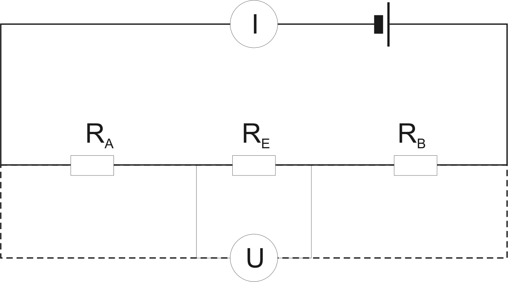

Daher verwendet man in der Regel getrennte Strom- und Spannungselektroden.
Das Potential an der Elektrode M muss auch gegen ein anderes Potential (Elektrode N) gemessen werden.
Auch diese kann weit weg (im Unendlichen) liegen, womit sich eine Pol-Pol-Messung ergibt, meist messen wir aber auf einer endlichen Strecke.

![4-Punktmessung [@Knoedel2005]](pics/ert/knoedelDE.png){fig-align="center"}

### Konfigurations/Geometrie-Faktor

Das Potential an der Elektrode M aufgrund Stromeinspeisung in A beträgt $u_{AM} = \rho I \frac{1}{2\pi \overline{AM}}$, ensprechend $u_{AN} = \rho I \frac{1}{2\pi \overline{AN}}$, $u_{BM} = \rho I \frac{1}{2\pi \overline{BM}}$ und $u_{BN} = \rho I \frac{1}{2\pi \overline{BN}}$.
Die gemessene Spannung $U$ ergibt sich aus der Überlagerung der Potentiale unter Berücksichtigung der Vorzeichen

$$ U = u_{AM} - u_{AN} - (u_{BM} - u_{BN}) $$

$$ U = \rho I \big( \frac{1}{2\pi \overline{AM}} - \frac{1}{2\pi \overline{AN}} - \frac{1}{2\pi \overline{BM}} + \frac{1}{2\pi \overline{BN}}\big)$$

Durch Umformung ergibt sich für den Widerstand
$$ \rho = \frac{U}{I} k \quad\mbox{mit}\quad k = \frac{2\pi}{\frac{1}{\overline{AM}}-\frac{1}{\overline{AN}}-\frac{1}{\overline{BM}}+\frac{1}{\overline{BN}}} $$

Dies gilt nur für ein homogenes Medium, im Allgemeinen kann diese Formel aber immer verwendet werden und es ergibt sich ein so-genannter *scheinbarer spezifischer Widerstand* (engl. apparent resistivity) $\rho_a$, der den spezifischen Widerstand für einen äquivalenten Untergrund angibt.

### Stetigkeit an Grenzflächen

Bisher sind wir von homogenen Medien ausgegangen, die zu linearen Stromlinien und kugelförmigen Potentiallinien führen.
An einer Grenzfläche zwischen zwei spez. Widerständen $\rho_1$ und $\rho_2>\rho_1$ weichen Potential und die Stromlinie davon ab.

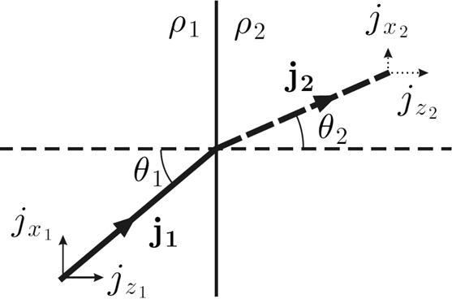

Aus der Kontinuitätsgleichung
$$\div(\sigma\vb E)=-\div(\sigma\grad u)=0$$
ergeben sich Stetigkeitsbedungen:

* das Potential ist stetig
* die Normalkomponente der Stromdichte ist stetig $j_{z1}=j_{z2}$
* die Tangentialkomponente des elektrischen Feldes ist stetig: $E_1=E_2\Rightarrow \rho_1 j_{x1}=\rho_2 j_{x2}$

Dividiert man beide Gleichungen, erhält man

$$\rho_1 \frac{j_{x1}}{j_{z1}}=\rho_2 \frac{j_{x2}}{j_{z2}}$$

bwz. $\rho_1\tan\theta_1=\rho_2\tan\theta_2$ das Brechungsgesetz:

$$\frac{\tan\theta_2}{\tan\theta_1}=\frac{\rho_1}{\rho_2}=\frac{\sigma_2}{\sigma_1}\quad. $$

### Verhalten an Grenzflächen

Betrachten wir eine Grenzfläche zwischen zwei Schichten mit Faktor 10 verschiedener Leitfähkeitkeit, einmal mit Einspeisung im guten Leiter und einmal im schlechten Leiter:

:::: {.columns}
::: {.column}
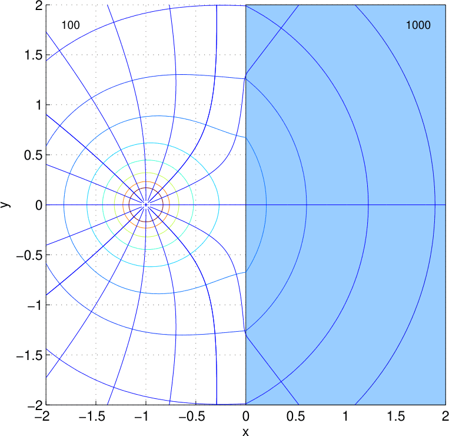
:::
::: {.column}
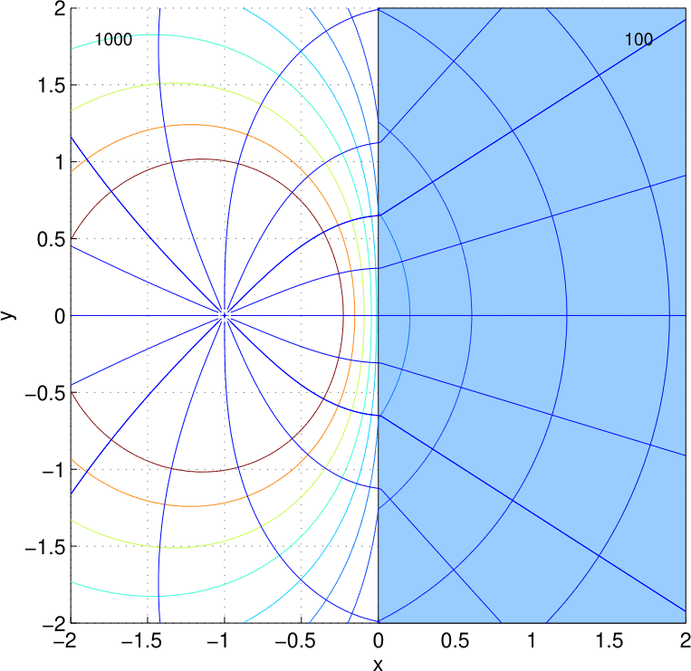
:::
::::

Die Stromlinien werden zum schlechten Leiterhin und vom guten weg gebrochen, während die Potentiallinien im schlechten Leiter mehr Raum einnehmen und sich im Übergang zum guten Leiter hin verdichten.

## Feldausbreitung

Wir studieren nun die Potentialverteilung für Oberflächenmessungen, zunächst für ein homogenes Medium

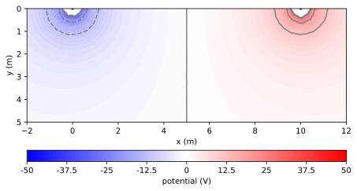

Dabei überlagern sich die kreisförmigen Potentiale der Stromelektroden mit verschiedenem Vorzeichen, so dass in der Symmetrielinie eine Nullinie ergibt.
Die Stromlinien ergeben sich als Gradienten des Potentials:

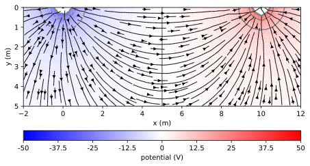

Wir bauen nun in einer Tiefe von 2m einen schlechten Leiter ein:

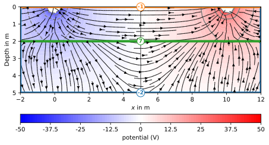

und sehen, dass die Stromlinien oberhalb sich parallel zur Grenzfläche ausbilden, während das Potential im schlechten Leiter verstärkt.

Wenn wir die Leitfähigkeiten vertauschen,

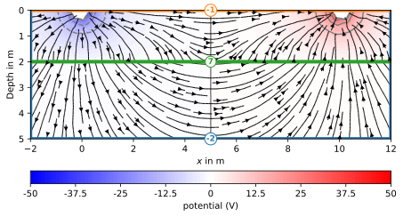

beobachten wir, dass die Stromlinien zum guten Leiter hingezogen werden und in diesem eher horizontal fließen.

### Inhomogener Untergrund

Für einen allgemeinen inhomogenen Untergrund
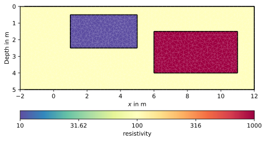

ist das Stromsystem komplexer:

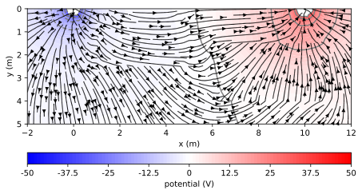

Auch hier wird der Stromfluss vom guten Leiter eingezogen und vom schlechten Leiter verdrängt.
Dabei wird die Null-Potentiallinie in Richtung des Schlechten Leiters verdrängt.
Hier ist aber die Lage der Anomalien von Bedeutung.
Wie genau Leitfähigkeits-Änderungen das Potentialfeld und damit die Messung verändern, wird mit dem Begriff Sensitivität beschrieben.

## Das Reziprozitätsprinzip

Das Reziprozitätsprinzip erlaubt die Vertauschung von Strom- und Potential-Elektroden und besagt:

::: {.callout-note title="Reziprozitätsprinzip"}
Sei $U_{AB}$ die von einer Stromeinspeisung $I_{AB}$ in die Stromelektroden erzeugte Spannung, und $u_{MN}$ die von einer Stromeinspeisung $I_{MN}$ in die Potentialelektroden erzeugte Spannung. Dann gilt für die Impedanz

$$ Z = \frac{U_{MN}}{I_{AB}} = \frac{U_{AB}}{I_{MN}} $$
:::

Es wird nach @Geselowitz1971 folgendermaßen hergeleitet:

Die Quellterme lauten $\vb j_s^{AB}=I_{AB}(\delta(\vb r-\vb r_A)-\delta(\vb r-\vb r_B))$ (Experiment 1) und $\vb j_s^{MN}=I_{MN}(\delta(\vb r-\vb r_M)-\delta(\vb r-\vb r_N))$ (Experiment 2)

$$ \div(u_1\vb j_2 - u_2\vb j_1) = \grad u_1 \vdot \vb j_2 + u_1\div \vb j_2 - \grad u_2 \vdot \vb j_1 - u_2 \div \vb j_1 $$

Das Ohmsche Gesetz ($\vb j=-\sigma\grad u$) wird in die Skalarprodukte eingesetzt

$$ \grad u_1\vdot \vb j_2 = -\frac{\vb j_1}{\sigma}\vdot j_2 = -\frac{\vb j_1 \vdot \vb j_2}{\sigma} = -\frac{\vb j_2}{\sigma}\vdot j_1 = \grad u_2\vdot \vb j_1 $$

Damit ergibt sich $\grad u_1 \vdot \vb j_2 - \grad u_2 \vdot \vb j_1=0$, wodurch sich die Gleichung vereinfacht

$$ \div(u_1\vb j_2-u_2\vb j_1) = u_1 \div\vb j_2 - u_2 \div\vb j_2 $$

Dies wird über das komplette Volumen $V$ integriert

$$ \int_V \div(u_1\vb j_2-u_2\vb j_1) \dd V = \int_V u_1 \div\vb j_2 - u_2 \div\vb j_2 \dd V $$

und mit Hilfe des Gauss-schen Satzes bzw. Greenschen Theorems die linke Seite in ein Oberflächen-Integral über die Oberfläche $S$ überführt

$$ \int_S (u_1\vb j_2-u_2\vb j_1)\vdot \vb n \dd S = \int_V u_1 \div\vb j_2 - u_2 \div\vb j_2 \dd V $$

Da durch die äußere Oberfläche kein Strom treten kann ($\vb j\vdot\vb n=0$), ist der linke Teil Null und es ergibt sich

$$ \int_V u_1 \div\vb j_2 \dd V = \int_V u_2 \div\vb j_2 \dd V $$

Die Divergenz von $\vb j$ ist überall Null außer an den Einspeisepunkten, d.h. das Volumenintegral löst sich auf

$$ u_1 I_{MN} (\delta(\vb r - \vb r_M)-\delta(\vb r-\vb r_N)) = u_2 I_{AB}(\delta(\vb r-\vb r_A)-\delta(\vb r-\vb r_B)) $$

womit sich das Reziprozitätsprinzip ergibt

$$ \frac{U_{MN}}{I_{AB}} = \frac{u_1(\vb r_M) - u_1(\vb r_N)}{I_{AB}} = \frac{u_2(\vb r_A) - u_2(\vb r_B)}{I_{MN}} = \frac{U_{AB}}{I_{MN}} $$

In der Herleitung haben wir Punktquellen ohne zusätzliche Kopplungswiderstände vorausgesetzt, die es in der Praxis aber nicht gibt, da die Stromdichte nicht unendlich werden kann.

## Ausgedehnte Elektroden

Im Allgemeinen braucht eine Elektrode eine endliche Fläche, um den Übergang des gesamten Stroms in den Untergrund zu gewährleisten, dabei entstehen auch Ankopplungswiderstände.
Für klassische 2D/3D-Geoelektrik sind das Spieße mit einer Länge $l$ und einer Dicke $d\ll l$, also Linienelektroden.
Bei versiegelten Flächen kommen aber auch Plattenelektroden zum Einsatz die (wie EKG-Elektroden in der Medizin) mit einem Gel angekoppelt werden.
In Bohrungen verwendet man auch Ringelektroden.
Die Form der Elektroden beeinflusst auch die Lösung, welche im Allgemeinen nur noch numerisch gelöst werden kann.
Nur für (balb)kugelförmige Elektroden bleibt die Lösung einfach: nach dem Newtonschen Kugelschalen-Theorem der Potentialtheorie ist sie (im Außenraum) identisch zur Punktquelle.

Zur numerischen Modellierung wird das aus der medizinischen Impedanztomographie entlehnte *Complete Electrode Model* (CEM) verwendet [@Ruecker2011].
Dabei wird die Elektroden diskretisiert (s. Abb. oben) und das Schaltbild entsprechend um Ankopplungswiderstände erweitert:

![Ersatzschaltbild für (a) Punktquelle und (b) ausgedehnte Quellen [@Ruecker2011]](pics/rueckerguenther2011_fig1.png)

Damit entstehen Zusätzliche Gleichungen für die Elektrodenoberfläche $\Gamma_l$, zum einen der Verteilung der Gesamtstromstärke

$$\int_{\Gamma_l}\sigma \pdv{u}{n}ds=I$$

und zum Anderen die Abhängigkeit des Potentials auf der Oberfläche von Messelektroden ($U_l$ ist das abgegriffene Potential).

$$z_l\sigma\pdv{u}{n} + u = U_l$$

### Modellierung von langen Elektroden

In der Praxis sind vor allem lange Elektroden (Spieße) relevant.
Dazu kann das Schaltbild vereinfacht werden, indem in der Modellierung Knoten über Shunt-Widerstände kurzgeschlossen werden [@Ronczka2015].
Die Potentialverteilung verändert sich dergestalt, dass im Bereich der Stecktiefe die Ströme horizontal fließen:

![Stromdichte für Langelektroden [@Ronczka2015]](pics/LE_Stromdichte.png)

Auch passive Elektroden (M und N) verzerren das Potentialbild, wie hier zu sehen ist.

### Einfluss der Stecktiefe

![Prozentuale Abweichung des Geometriefaktors versch. Anordnungen in Abhängigkeit von der Stecktiefe [@Ruecker2011]](pics/rueckerguenther2011_tab1.png)

### Langelektroden - Sensitivitäten

:::: {.columns}
::: {.column}
![[@Ronczka2015]](pics/LE_sens1.png)
:::
::: {.column}
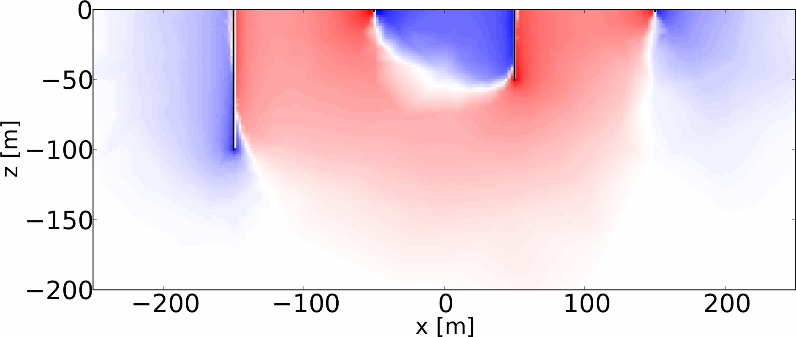
:::
::::

### Anwendung

Die Verwendung stahlverrohrter Bohrungen als Elektroden wird als Lang-Elektroden-Geoelektrik bezeichnet, wie z.B. im Projekt SaMoLEG (Salzwasser-Monitoring mittels Langelektroden-Geoelektrik).

:::: {.columns}
::: {.column}
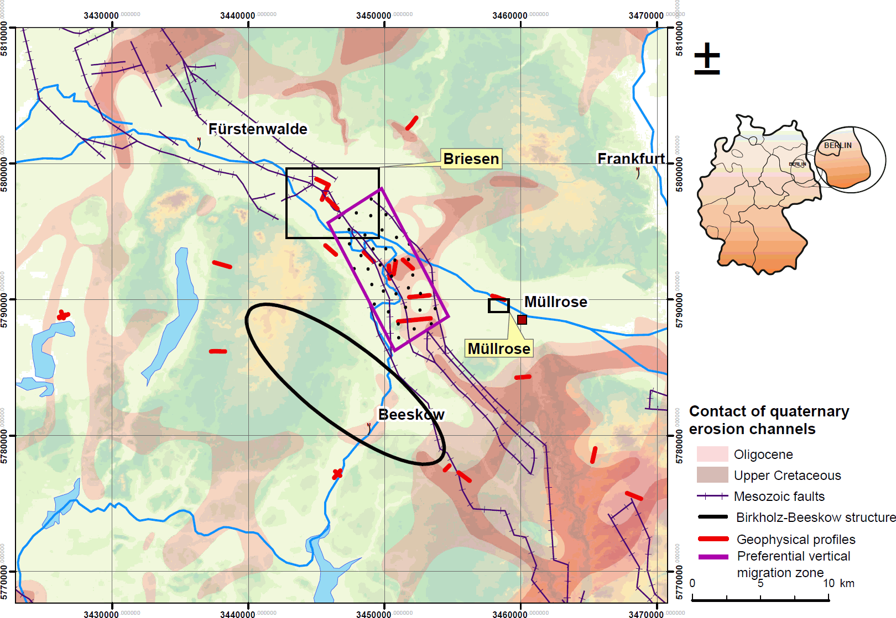
:::
::: {.column}
* stahlverrohrte Bohrlöcher als Elektroden [@Guenther2015]

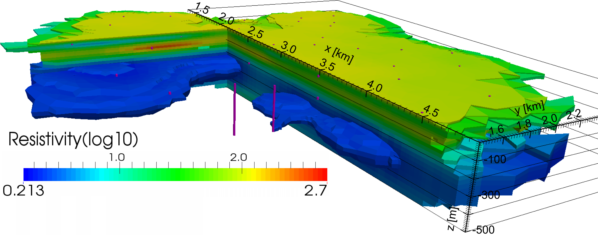{.fragment}
:::
::::

Ringelektroden finden in Bohrloch-Installationen, z.B. in automatisierten Messtellen Einsatz, z.B. beim Salzwasser-Monitoring-System [SAMOS](https://www.liag-institut.de/samos.html).
Zur Berechnung muss die Oberfläche der Elektrode in der Vorwärtsrechnung mit diskretisiert werden.
Für die Inversion muss entweder ein solches Netz benutzt werden, alternativ kann eine Korrektur der Daten mit dem Geometrie-Effekt endlicher Elektroden (und hier der gesamten Installation) erfolgen.

:::: {.columns}
::: {.column width="46%"}
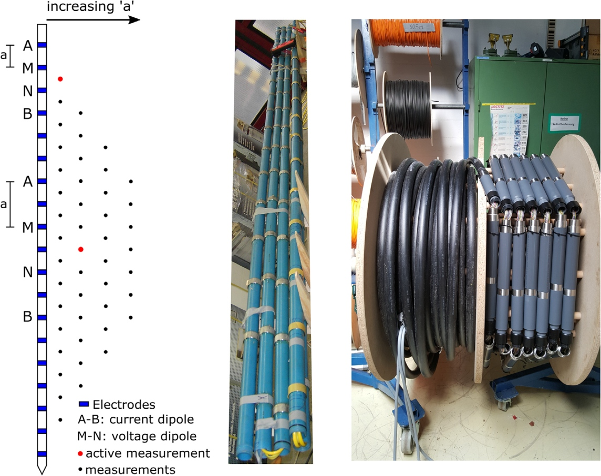
:::
::: {.column width="53%" .fragment}
![Modellierung Ringelektroden [@Ronczka2015]](pics/SAMOS-Ringelektroden.png)
:::
::::
